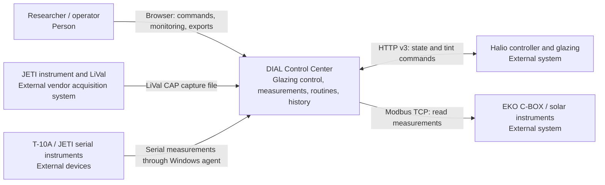
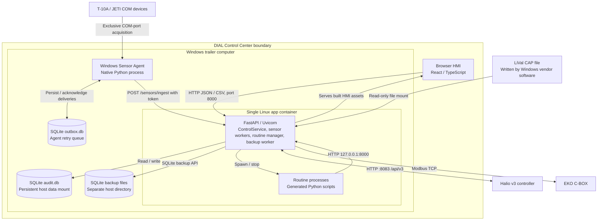

# DIAL Control Center: system design

Implementation baseline: `cc20ba6`, reviewed against code on 2026-10-29.
This describes the current system; proposed work and unresolved behavior are
identified below. It does not establish acceptance of any RFC.

## Purpose and context

DIAL Control Center supports OSU's mobile daylighting research trailer.
Researchers use a browser HMI to command electrochromic glazing, inspect live
illuminance and spectral/solar measurements, export history, and run Python
study routines. The system operates locally on the trailer computer; development
provides simulated panels and sensors without trailer access.

The diagrams use the [C4 model](https://c4model.com/) at context and container
levels, expressed in Mermaid as in [the existing architecture diagram](architectureDiagram.md).
Arrows name interactions. External boxes represent hardware or vendor software;
C4 containers represent applications and stores, not necessarily Docker containers.

### Level 1: system context

### Level 2: applications and stores

## Responsibilities and boundaries

[ControlService](../svc/app/service.py) selects `Simulator` in development and
`HalioAdapter` in production. Production panel IDs, groups, and live tint come
from Halio; local panel state records commanded values. Application group
mutations are development-only. The adapter may create missing single-window
groups on Halio to support individual commands ([ADR 0001](adr/0001-halio-is-the-source-of-truth-for-panels.md)).

The service owns network/file acquisition and production `audit.db`. Devices
marked `acquisition: external` are registered by the service but opened only by
the Windows Sensor Agent. The agent owns its separate durable outbox and forwards
observations; it never writes `audit.db` ([ADR 0002](adr/0002-the-container-owns-network-sensors-and-the-agent-owns-com-ports.md)).
Sensor startup/polling errors and stale external readings degrade health instead
of selecting simulated production data. Invalid configuration fails startup
before database initialization.

The HTTP application currently has no general user authentication or roles.
The ingest token protects only sensor ingestion; command `actor` is supplied by
the client, not verified identity. Halio v3 itself relies on LAN isolation
([ADR 0005](adr/0005-halio-v3-is-unauthenticated-and-lan-only.md)). Routine code
runs as ordinary `python3` subprocesses with the service's permissions, without
a sandbox. Their supplied helpers call the HTTP API, but arbitrary Python can
access other resources. Network access to the app therefore grants substantial
control. Remote access and its authorization boundary remain undecided.

## Interfaces and contracts

[Routes](../svc/app/routes.py) and [Pydantic models](../svc/app/models.py) define
the HTTP contract; a running service exposes it at `/api/openapi.json` and
`/api/docs`. [The web client](../web/src/api.ts) consumes those contracts. API paths
are unprefixed (`/panels`, not `/api/panels`); `/api` hosts the API documentation.
JSON timestamps are Unix seconds; routine `interval_ms` is milliseconds.

| Boundary | Current contract |
| --- | --- |
| HMI / routines to control API | `GET /panels`, `GET /groups`; `POST /commands/set-level` takes `{target_type: "panel" \| "group", target_id, level: 0..100, actor?}` and returns `{ok, applied_to, message}`. Success is HTTP 200 for command acceptance, not physical transition completion. Missing targets map to 404, dwell rejection to 429, and model validation to 422. `SVC_MIN_DWELL_SECONDS` defaults to 20; implementation limits are listed below. |
| HMI to configuration APIs | `POST /groups` takes `{name, member_ids}`; `PATCH /groups/{group_id}` updates either field; `DELETE /groups/{group_id}` removes a group. These operations are development-only. `PATCH /sensors/{sensor_id}` takes optional `custom_label` and `device_custom_label` for T-10A labels stored in SQLite. Configuration files remain read-only. |
| HMI to monitoring / history | `GET /health`, `/sensors`, `/metrics/latest`, `/metrics/history`; spectrum endpoints under `/sensors/{sensor_id}/spectrum/`. Scalar readings contain `sensor_id, metric, value, ts`; spectra include wavelength bounds, step, and values. Audit and sensor logs use `/logs/audit` and `/logs/sensors`, with `/export` CSV variants. Exact filters and limits are in OpenAPI. |
| HMI to routines | `GET/POST /routines`, `POST /routines/{routine_id}/stop`, `DELETE /routines/{routine_id}`; `/saved-routines` stores reusable code. Requests carry `name, code, mode` (`once` or `interval`) and optional interval/schedule settings. Records persist; running/scheduled routines resume on service startup. Logs are held in memory. |
| Agent to service | `POST /sensors/ingest`, header `X-Sensor-Ingest-Token`; body `{events: [...]}` with 1–1,000 events. Each event requires `event_id, sensor_id, observed_ts > 0, metrics` (1–256 finite values); optional finite spectrum has 1–10,000 values, wavelength start/step defaulting to 380/1. Extra fields are forbidden. Returns `{accepted, duplicates}`; disabled ingestion is 404, bad token 401, invalid/unknown/inactive sensor 422. |
| Drivers to acquisition worker | [SensorClient](../svc/app/sensors/interface.py): `id` and `poll() -> Iterable[SensorReading]`; each reading has `sensor_id, metric, value, ts` and optional spectrum. Device transport, polling interval, head IDs, and acquisition ownership come from `sensors_config.json`. See [production setup](production_sensor_setup.md). |
| Service to Halio | [HalioAdapter](../svc/app/adapter.py) maps v3 windows/groups to panels/groups and posts `{level}` to `/sites/{site_id}/groups/{group_id}/tint`. Vendor HTTP 202 means queued. An accepted group command can return no known member IDs. Optional `HALIO_API_KEY` is sent only when configured. |
| LiVal to watcher | [CAP parser](../svc/app/sensors/jeti_spectraval_watcher.py) consumes complete, semicolon-delimited rows: zero-based date/time fields 1/2, lux field 5, spectra from field 8. Date/time format is `%m/%d/%Y %I:%M:%S%p`; `source_timezone` supplies the zone, otherwise process-local time applies. Unparseable timestamps fall back to ingestion time. The watcher defaults to starting at EOF and checkpoints acknowledged progress in the data directory. |

Ingestion commits a batch atomically. Reused `event_id` or an already recorded
`(sensor_id, observed_ts)` skips the entire observation, even if its payload
differs. Unknown/inactive sensors reject the batch. The agent retains events
until delivery is acknowledged and retries failures; file checkpoints advance
after persistence. These semantics matter when clocks or multiple producers
assign the same timestamp.

CSV exports use UTC timestamp text. Audit columns are `Timestamp, Actor, Target
Type, Target ID, Level, Applied To, Result`; sensor columns are `Timestamp, Sensor
ID, Sensor Kind, Sensor Label, Metric, Value`.

Before two contributors implement opposite sides of a boundary, agree in the PR
on fields, units, timestamps, errors, ownership, and retry behavior, with a sample
payload or fixture. Preserve the existing API contract as required by
[AGENTS.md](../AGENTS.md); a needed API change requires a separate resolution.

## Data model and persistence

[state.py](../svc/app/state.py) defines and initializes SQLite tables. The service
is the application owner of `audit.db`; acquisition, API handlers, and routine
management use separate connections within that service.

| Entity / table | Identity, relationships, and persisted content |
| --- | --- |
| `panel_state`, `groups` | Panel ID → commanded level and last-change timestamp; group ID → name and JSON member-ID list. Development panel structure comes from config; production topology comes from Halio. |
| `audit_log` | Autoincrement ID; timestamp, client actor, target type/ID, requested level, JSON applied-panel IDs, result. ControlService records outcomes; some early errors bypass audit, and hardware acceptance and database writes are not one transaction. |
| `sensors` | Sensor ID primary key; kind, label, location, config JSON, active flag. One device may expose several head/sensor IDs. |
| `sensor_readings` | Autoincrement ID; sensor ID, timestamp, metric, numeric value. One sensor has many readings; indexes cover `(sensor_id, metric, ts)` and `ts`. |
| `sensor_spectra` | Composite key `(sensor_id, ts)`; wavelength start/end/step and JSON values. Associated with scalar observations by sensor ID and timestamp. |
| `sensor_ingest_events` | Event ID primary key; sensor ID, observed and received timestamps, source. Supplies ingestion deduplication and external freshness tracking. |
| `routines`, `saved_routines` | Routine ID → code, schedule, mode, status; saved routine name → code. Generated scripts live under the data directory; live process handles and logs do not survive restart. |

Sensor tables declare references to `sensors`; the connection helper currently
does not enable SQLite foreign-key enforcement. Ingestion validates active IDs
in application code. Metric units are implicit in driver conventions (`lux`,
`ghi_w_m2`, etc.); there is no metric catalog or recorded schema version yet.
Preserve historical names and IDs. Research readings and audit history need
durable storage; UI control-priority maps are browser memory, not shared locks.

## Deployment and recovery

### Production target

The walking skeleton runs in week 10 of fall 2026 on the Windows trailer PC,
as the combined image under [production Compose](../docker-compose.yml) with
Docker ([ADR 0007](adr/0007-docker-is-the-only-supported-container-runtime.md)).
It serves the HMI and API on port 8000 to browsers on the Halio network,
commands the Halio controller, and records at least one instrument's readings
in the production `audit.db`. The trailer PC moved from Podman to Docker in
#86. The project partner owns the trailer PC and its accounts and
infrastructure, and agreed this target on 2026-10-22. The HMI is reachable
only from networks in the trailer, so it has no public URL; the evidence of a deployment is an issue reporting the
on-site run, with the commit deployed and the `/health` response.

### Runtime shape

The [Dockerfile](../Dockerfile) builds the React/Vite assets with Node 24 and
packages them with Python 3.14/FastAPI. One Uvicorn process serves both static
assets and APIs on port 8000; there is no separate web server or database server.
Sensor/backup workers and routine scheduling run in that process. The HMI polls
every five seconds. Scaling to multiple API workers would require coordinating
acquisition and scheduling first.

[Production Compose](../docker-compose.yml) runs on the Windows trailer host
with explicit bind mounts: data at `/app/svc/data`, read-only configuration at
`/app/svc/config`, a read-only LiVal capture at
`/app/svc/sensor-input/specbos-lival.capture`, and backups at `/app/db-backups`.
The native agent is a separate host process when external devices are enabled.
Halio LAN and EKO network reachability must both be available. Site values and
tokens belong in ignored local configuration, never this document.

`SVC_ENVIRONMENT` is required. Local development defaults to
`svc/.runtime/development`; [development Compose](../docker-compose.development.yml)
uses its own named volume. Production has explicit data/config paths and never
shares development storage ([ADR 0004](adr/0004-production-and-development-never-share-a-data-directory.md)).
For split development, Vite uses `VITE_API_BASE`; see [DEV-SETUP.md](../DEV-SETUP.md).

Production defaults to a consistent SQLite backup at startup and every 24 hours;
development Compose disables backups. Compose restarts the app unless stopped.
Its health check tests HTTP 200, so a degraded JSON health response still passes.
Use [production preflight](../scripts/production_preflight.py) before upgrades;
backup retention and a verified restore procedure remain open operational work.

## Deferred decisions and open technical questions

| Question / deliberately deferred choice | Current limit and evidence needed |
| --- | --- |
| Reliable failure display and command safety | `/health` checks sensors, not Halio. The adapter can return empty lists or zero tint after failed reads; command failures may be reported as dwell errors. Production group commands currently bypass a local dwell check. Which failure representation and interlock should be agreed without breaking the API? Verify against controller behavior. |
| Freshness, clocks, and control ownership | External freshness uses receipt time, so delivery of old backlog can appear fresh. Timestamp collisions discard whole observations. Browser manual/group/routine priority does not arbitrate across clients. Define acceptable data age, clock handling, and conflicting-command behavior before concurrent studies. The HMI's explicitly marked mock fallback also needs operator review. |
| Metric vocabulary and migrations | [RFC-0006](adr/rfc-0006-uniform-modular-sensor-data-model.md) proposes a catalog, driver registry, and schema versioning; all remain proposed. Agree units and migration compatibility before adding new stored metrics; measure SQLite growth/query/backup performance before choosing another store or retention policy. |
| Remote access and authorization | Docker is the only supported container runtime ([ADR 0007](adr/0007-docker-is-the-only-supported-container-runtime.md)), and the trailer PC runs it (#86). [RFC-0008](adr/rfc-0008-remote-connection-configuration.md) (Tailscale) remains proposed and is not an accepted deployment decision. Confirm partner requirements for access, routine execution, maintenance, and network isolation before enabling remote control. |

### Proposed spike and review

Time-box a sensor-delivery spike to **two working days**, owned by the sensor
integration maintainer with a teammate who did not author the integration as
reviewer. This is a plan, not a completed experiment. Use synthetic CAP rows and
fake serial clients with development storage; do not connect to live controls.
Exercise the Windows agent and Linux container through API outages, interrupted
acknowledgments, process restarts, partial file rows, and delayed backlog delivery.
Pass criteria: every unique observation persists once after retry, partial rows
wait for completion, acknowledged checkpoints resume correctly, and an outage
is visible. Record observed-versus-received freshness behavior and timestamp
collision losses explicitly; neither is assumed solved. Record measurements,
failures, and the resulting decision in an ADR before changing the contract.
Real-device/calibration verification is a separate on-site check.

Review this design with a non-author teammate by tracing a tint command, a
sensor observation, and recovery after restart through both diagrams and the
contracts. Review is pending; record reviewer/date and unresolved findings in
the PR. Each boundary/schema/deployment change should update this document and
affected fixtures in the same PR; record expensive decisions separately in
[docs/adr](adr/). Give this document to each teammate's approved AI tool alongside
AGENTS.md and review generated code against its boundaries as well as tests.
This maintenance/review approach follows the
[technical design guide](https://capstone.alexulbrich.com/guides/technical-design/).
